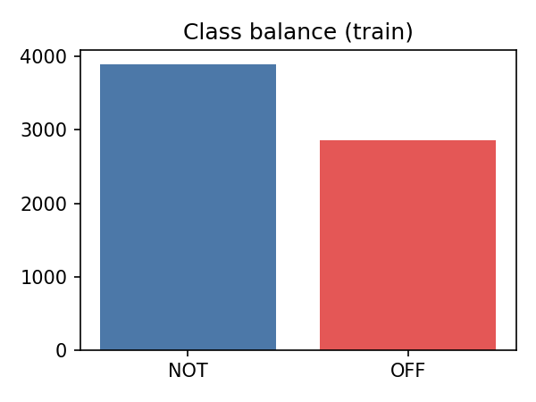
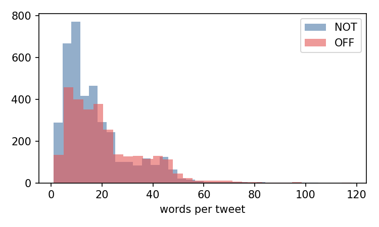
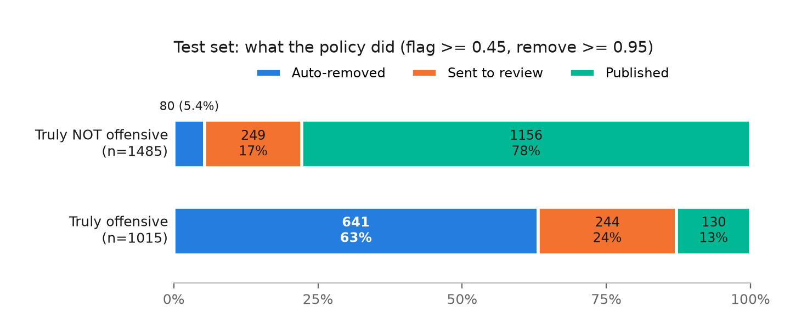
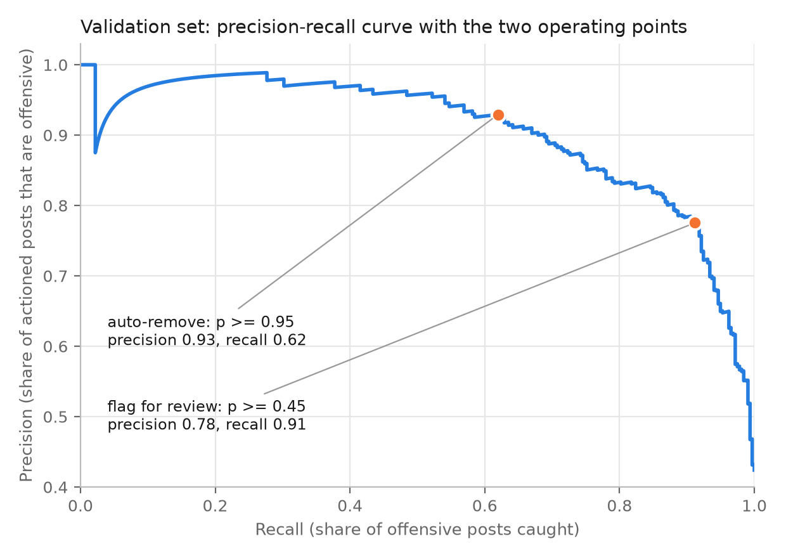

# Detecting Offensive Sinhala Text: a Deployable and Explainable Detector

**CS5998 Capstone | MSc in Data Science & AI, University of Moratuwa**
**Status: Milestone 2, Technical Checkpoint**

A binary classifier (offensive / not offensive) for Sinhala tweets, built on the public [SOLD](https://huggingface.co/datasets/sinhala-nlp/SOLD) dataset, plus a working **moderation system** that turns model scores into a three-way policy (auto-remove / send to human review / publish) with explanations and an audit trail.

The project asks three questions:

1. **Accuracy.** How much better is a fine-tuned transformer than a TF-IDF baseline, and is the difference statistically real?
2. **Explainability.** Can the system show a moderator *which words* drove a decision?
3. **Deployability.** What does each model cost (size, latency), and what happens to real moderation quality when scores are turned into automatic actions?

Everything runs locally. **No external LLM API is used.**

> **Content warning.** The dataset and the demo contain offensive language.

---

## Contents

- [Headline results](#headline-results)
- [Milestone 2 deliverables](#milestone-2-deliverables)
- [System architecture](#system-architecture)
- [Data and preprocessing](#data-and-preprocessing)
- [Methods](#methods)
- [Results in detail](#results-in-detail)
- [Moderation policy and its evaluation](#moderation-policy-and-its-evaluation)
- [Limitations](#limitations)
- [Reproducing everything](#reproducing-everything)
- [Repository layout](#repository-layout)
- [Roadmap to the final report](#roadmap-to-the-final-report)
- [References and acknowledgements](#references-and-acknowledgements)

---

## Headline results

Test-set macro-F1 (official 2,500-tweet SOLD test split, scored once with the validation-selected configuration):

| Model | Test macro-F1 | Seeds |
|---|---|---|
| TF-IDF + LinearSVM (baseline) | **0.773** | deterministic |
| SinBERT-large (fine-tuned) | **0.808 ± 0.007** | 3 (42, 1, 2) |
| XLM-R base (fine-tuned) | **0.831 ± 0.011** | 3 (42, 1, 2) |

- Both transformers are **significantly better** than the baseline (McNemar, Holm-adjusted p < 0.001; bootstrap 95% CIs exclude zero).
- XLM-R scored higher than SinBERT on every seed, but the paired test on the seed-42 runs shows **no significant difference** (p = 0.66), so the two are treated as comparable.
- The transformers gain about 3 to 5 macro-F1 points but are **150 to 350 times larger** and about **70 to 120 times slower** per tweet than the baseline.
- With thresholds chosen on validation data only, the three-way policy auto-removed offensive posts with **88.9% precision on the test set**, slightly below the 90% target. **80 benign posts (5.4%) were wrongly auto-removed** and about **20% of all posts** go to human review. These are reported as measured, not tuned away.

---

## Milestone 2 deliverables

| Requirement | Where to find it |
|---|---|
| Data preprocessing completed | [`src/preprocess.py`](src/preprocess.py), split logic in [`src/data.py`](src/data.py) |
| Exploratory data analysis | [`eda.py`](eda.py), outputs in [`results/eda/`](results/eda) (figures + `eda_summary.json`) |
| Baseline implemented | [`run_baseline.py`](run_baseline.py), [`src/baseline.py`](src/baseline.py), results in [`results/baseline.json`](results/baseline.json) |
| Improved method implemented | [`finetune.py`](finetune.py) (XLM-R base, SinBERT-large), results in `results/xlmr*.json`, `results/sinbert*.json` |
| Statistical comparison | [`significance.py`](significance.py), tables in [`results/significance.md`](results/significance.md) |
| System architecture diagram | [`docs/architecture.png`](docs/architecture.png) |
| Working system | [`moderation/`](moderation) (social feed + scanner API + moderator dashboard) and [`app.py`](app.py) (single-post explainer) |
| Policy analysis | [`policy_analysis.py`](policy_analysis.py), outputs in `results/policy_*` |
| Demo video (max 6 min) | *link to be added at submission* |

---

## System architecture

The diagram is in [`docs/architecture.png`](docs/architecture.png) (editable source: [`docs/architecture.svg`](docs/architecture.svg)).

**Offline (top).** SOLD is preprocessed and split, three models are trained and compared, the chosen model is calibrated into a three-way policy on validation data, and that policy is evaluated once on the test set.

**Online (bottom).** A browser feed and a moderator dashboard talk to a FastAPI backend. Each new post or comment is scored by the fine-tuned model, which also produces a word-level explanation. The policy turns the score into a decision, and everything (score, words, thresholds used, moderator actions) is stored in SQLite for audit.

---

## Data and preprocessing

**Dataset.** SOLD (Ranasinghe et al.): 10,000 manually annotated Sinhala tweets with sentence-level labels (`OFF` / `NOT`) and token-level rationales. Loaded from the Hugging Face hub (`sinhala-nlp/SOLD`): 7,500 official train rows and 2,500 official test rows.

**Splits** (fixed by `SEED = 42` in [`src/config.py`](src/config.py)):

| Split | Rows | Use |
|---|---|---|
| Train | 6,750 | fitting |
| Validation | 750 | model and epoch selection, threshold calibration |
| Test | 2,500 | official test split, scored once for final numbers |

Train and validation come from a **stratified 90/10 split** of the official training set. About **42.3%** of training tweets are offensive, so macro-F1 is used as the main metric and class weights are applied during training.

**Preprocessing** ([`src/preprocess.py`](src/preprocess.py)). Each step is a flag so it can be ablated:

- Unicode NFC normalisation
- URLs removed
- `@mentions` removed (optional: `keep_mentions`)
- Emoji removed (optional: `keep_emoji`), while **preserving the zero-width joiner**, which Sinhala uses inside consonant conjuncts
- Whitespace collapsed

**EDA** ([`eda.py`](eda.py) → [`results/eda/`](results/eda)) covers class balance, tweet length by class, URL / mention / emoji rates, duplicate texts, train/test text overlap, and the most class-associated words (smoothed log-odds).

<p>


</p>

---

## Methods

**Baseline.** TF-IDF features (word 1-2-grams plus character 2-5-grams within word boundaries, sublinear TF, `min_df=2`) with logistic regression or a linear SVM, `C ∈ {0.1, 1, 10}`, balanced class weights. The configuration is chosen by **validation** macro-F1; the selected model is **LinearSVM, C = 1** (validation macro-F1 0.803).

**Improved method.** Fine-tuning two pre-trained transformers for sequence classification:

| | XLM-R base | SinBERT-large |
|---|---|---|
| Checkpoint | `xlm-roberta-base` | `NLPC-UOM/SinBERT-large` |
| Parameters | 278 M | 126 M |
| Type | multilingual | Sinhala-specific RoBERTa |

Shared settings: 4 epochs, learning rate 2e-5, batch size 16, max length 128, weight decay 0.01, fp16, **class-weighted cross-entropy** (offensive-class weight about 1.36), and the **best epoch is picked on validation macro-F1**. Each model is trained with seeds 42, 1 and 2; the data split never changes between seeds. Hardware: Google Colab, Tesla T4.

**Explainability.** *Leave-one-word-out occlusion*: each word's impact is the drop in P(offensive) when that word is removed. It is local, needs no external service, and is shown as highlighted words in the demo and dashboard. *Known weakness:* when a post contains two overlapping insults, removing either one barely changes the score, so occlusion under-credits redundant cues.

**Statistical testing** ([`significance.py`](significance.py)). Exact McNemar tests on paired test predictions, Holm correction across the three comparisons, and a paired bootstrap (10,000 resamples) for the macro-F1 difference.

---

## Results in detail

### Accuracy across seeds (test)

| Model | Seed 42 | Seed 1 | Seed 2 | Mean ± std |
|---|---|---|---|---|
| TF-IDF + LinearSVM | 0.7734 | n/a | n/a | n/a |
| SinBERT-large | 0.8069 | 0.8156 | 0.8021 | 0.8082 ± 0.0068 |
| XLM-R base | 0.8185 | 0.8403 | 0.8330 | 0.8306 ± 0.0111 |

Seed-to-seed variation is about 1 point, which is the same size as the gap between the two transformers on any single seed. This is why single-run comparisons are not trusted here.

### Significance (seed-42 runs)

| Comparison | Δ macro-F1 | Holm-adj. p (McNemar) | 95% bootstrap CI of Δ | Verdict |
|---|---|---|---|---|
| SinBERT − baseline | +0.034 | < 0.001 | [+0.016, +0.051] | significant |
| XLM-R − baseline | +0.045 | < 0.001 | [+0.027, +0.064] | significant |
| XLM-R − SinBERT | +0.012 | 0.66 | [−0.005, +0.028] | not significant |

Seed 42 happens to be XLM-R's weakest run, so this is the most conservative comparison available. Full tables: [`results/significance.md`](results/significance.md).

### Deployment cost

| Model | Parameters | Size on disk | CPU latency per tweet (batch 1) | Training time (T4) |
|---|---|---|---|---|
| TF-IDF + LinearSVM | n/a | 3.2 MB | 2.2 ms | seconds |
| SinBERT-large | 126 M | 504 MB | 215 to 264 ms | 4 to 6 min |
| XLM-R base | 278 M | 1,112 MB | 162 to 247 ms | 6 to 7 min |

Latency is measured one tweet at a time on 100 test tweets, including cleaning and tokenisation. The transformer figures were measured on Colab CPUs (which varied between sessions, hence the ranges) and the baseline on the author's PC, so absolute comparisons are indicative; the orders of magnitude are not in doubt.

---

## Moderation policy and its evaluation

Scores are turned into actions with two thresholds:

| Score p (offensive) | Action |
|---|---|
| p ≥ **0.95** | auto-remove, alert the author |
| **0.45** ≤ p < 0.95 | publish but queue for human review |
| p < **0.45** | publish |

**How the thresholds were chosen (validation set only).** *Remove* = the lowest threshold at which at least 90% of the posts above it are truly offensive; *flag* = the highest threshold at which at least 90% of all offensive posts are caught. Calibration code: [`moderation/calibrate.py`](moderation/calibrate.py).

**Sensitivity to the precision target (validation, n = 750):**

| Precision target | Remove ≥ | Auto-removed | Sent to review | Removal precision |
|---|---|---|---|---|
| 0.85 | 0.80 | 36.9% | 12.9% | 85.9% |
| **0.90 (chosen)** | **0.95** | 28.3% | 21.6% | 92.9% |
| 0.95 | none reaches it | 0% | 49.9% | n/a |

A stricter target would mean no automatic removal at all: no threshold on the 0.05-step grid (up to 0.95) reaches 95% precision on the validation set.

**One-time test-set evaluation (n = 2,500; thresholds fixed beforehand):**

| True label | Auto-removed | Sent to review | Published | Total |
|---|---|---|---|---|
| Not offensive | 80 (5.4%) | 249 (16.8%) | 1,156 (77.8%) | 1,485 |
| Offensive | 641 (63.2%) | 244 (24.0%) | 130 (12.8%) | 1,015 |



| Measure | Value |
|---|---|
| Removal precision | 88.9% (target 90%; validation said 92.9%) |
| Benign posts wrongly auto-removed | 80 (5.4% of benign posts) |
| Offensive posts caught (removed + review) | 87.2% |
| Offensive posts missed (published) | 12.8% |
| Human review workload | 19.7% of all posts |
| Share of the review queue that is truly offensive | 49.5% |
| Expected calibration error | 0.089 |



**Reading.** The validation estimate of removal precision was slightly optimistic, which is typical when a threshold is picked on a small validation set (only 212 validation posts were auto-removed). Roughly 1 in 18 benign posts being auto-removed is why the system keeps **human override, author alerts and an audit log** rather than acting fully automatically.

### Illustrative behaviour (anecdotal, not a measured result)

| Post (type) | Score | Outcome |
|---|---|---|
| clear personal insult | 0.996 | auto-removed |
| mild insult | 0.889 | flagged for review |
| insulting phrase, one extra word | 0.925 | flagged for review |
| criticises an action, not a person | 0.128 | published |
| strong word used about food | 0.014 | published |
| short insulting phrase | 0.058 | **published (a likely miss)** |

The last two rows show the model is not fooled by a "bad word" used innocently, and also that it can be sensitive to small wording changes. These are single examples used to motivate the planned error analysis.

---

## Limitations

- **One dataset, one platform.** SOLD is tweets from a specific period; results may not transfer to other platforms or newer slang.
- **Sinhala script only.** Romanised Sinhala ("Singlish") is out of scope.
- **Three seeds.** Enough to see the variation, not enough for tight confidence intervals; the XLM-R vs SinBERT question stays open.
- **Auto-removal is imperfect.** 5.4% of benign posts were removed in the test evaluation, and 12.8% of offensive posts slipped through. The prototype assumes a human reviewer.
- **Occlusion explanations are approximate.** They under-credit redundant words, and have not yet been checked against the dataset's human rationales.
- **Latency is hardware-dependent.** Measured on different machines (see above).
- **The demo has no authentication** and is for local use only.

---

## Reproducing everything

Developed on Windows (cmd + venv) and Google Colab (T4). Fine-tuning needs a GPU; everything else runs on CPU.

**1. Setup**

```
git clone https://github.com/thimethj26-UOM-MDSAI/Capstone-Project.git
cd Capstone-Project
python -m venv venv
venv\Scripts\activate                 (macOS/Linux: source venv/bin/activate)
pip install -r requirements.txt -r moderation/requirements.txt
```

**2. Preprocessing, EDA and baseline** (CPU, minutes)

```
python eda.py
python run_baseline.py                # writes results/baseline.json + baseline_test_preds.npy
```

**3. Fine-tune the transformers** (Colab T4; about 4 to 7 minutes per run)

```
python finetune.py --model xlm-roberta-base      --out models/xlmr
python finetune.py --model NLPC-UOM/SinBERT-large --out models/sinbert
# extra seeds (the split is fixed; only training randomness changes)
python finetune.py --model xlm-roberta-base      --out models/xlmr_s1    --seed 1
python finetune.py --model xlm-roberta-base      --out models/xlmr_s2    --seed 2
python finetune.py --model NLPC-UOM/SinBERT-large --out models/sinbert_s1 --seed 1
python finetune.py --model NLPC-UOM/SinBERT-large --out models/sinbert_s2 --seed 2
```

Each run writes `results/<name>.json` and `results/<name>_test_preds.npy`. Model weights are **not** committed (about 0.5 to 1.1 GB each); re-create them with the commands above.

**4. Significance tests**

```
python significance.py                # reads results/*_test_preds.npy, writes results/significance.*
```

**5. Policy calibration and analysis** (needs the XLM-R folder)

```
python -m moderation.calibrate --model "path\to\xlmr"
python policy_analysis.py --model "path\to\xlmr"
```

The analysis evaluates the saved thresholds on the test set **once**; re-running skips the test section unless `--force` is passed, so thresholds cannot be quietly re-picked.

**6. Run the demos**

```
python app.py --model "path\to\xlmr"                 # single-post explainer (Gradio)
python -m moderation.run --model "path\to\xlmr"      # social feed + moderator dashboard
```

Then open <http://127.0.0.1:8000/> (feed) and <http://127.0.0.1:8000/admin> (moderator dashboard). See [`moderation/README.md`](moderation/README.md).

### Reproducibility notes

| Item | Value |
|---|---|
| Dependencies | `requirements.txt`, `moderation/requirements.txt` |
| Hardware | Google Colab Tesla T4 (training); CPU for analysis and demo |
| Random seeds | split seed 42; training seeds 42, 1, 2 |
| Data | public, `sinhala-nlp/SOLD` on Hugging Face (downloaded automatically) |
| Hyperparameters | 4 epochs, lr 2e-5, batch 16, max length 128, weight decay 0.01, class-weighted CE |
| Selection rule | best epoch and baseline configuration chosen on validation macro-F1 |

---

## Repository layout

```
├── src/
│   ├── config.py            seeds, split fraction, paths
│   ├── data.py              load SOLD, build train/val/test
│   ├── preprocess.py        cleaning (each step is a flag)
│   └── baseline.py          TF-IDF + LR/SVM, metrics, size and latency
├── eda.py                   exploratory analysis → results/eda/
├── run_baseline.py          baseline entry point
├── finetune.py              transformer fine-tuning (--seed supported)
├── significance.py          multi-seed summary, McNemar, bootstrap
├── policy_analysis.py       policy sensitivity, one-time test evaluation, figures
├── app.py                   Gradio single-post explainer
├── moderation/              social feed, scanner, moderator dashboard
│   ├── server.py  scanner.py  db.py  run.py  calibrate.py
│   ├── thresholds.json      calibrated on validation data
│   └── static/              index.html (feed), admin.html (dashboard)
├── docs/                    architecture diagram
└── results/                 metrics, predictions, tables, figures
```

---

## Roadmap to the final report

- Bias and false-positive analysis (which kinds of benign posts get flagged, and why)
- Agreement between occlusion explanations and SOLD's human token-level rationales
- Emoji-handling ablation
- Additional error analysis on wording sensitivity
- Optional: SemiSOLD for extra training data; a small romanised-Sinhala robustness check
- Final report with limitations and trade-offs, and the reproducibility checklist

---

## References and acknowledgements

- Ranasinghe, T., Anuradha, I., Premasiri, D., Silva, K., Hettiarachchi, H., Uyangodage, L., Zampieri, M. (2025). *SOLD: Sinhala Offensive Language Dataset.* Language Resources and Evaluation, 59, 297-337. <https://doi.org/10.1007/s10579-024-09723-1>
- Dhananjaya, V., Demotte, P., Ranathunga, S., Jayasena, S. (2022). *BERTifying Sinhala: A Comprehensive Analysis of Pre-trained Language Models for Sinhala Text Classification.* LREC 2022, pp. 7377-7385. (source of SinBERT)
- Conneau, A., et al. (2020). *Unsupervised Cross-lingual Representation Learning at Scale.* ACL 2020. (XLM-R)

**Use of AI tools.** An AI assistant (Claude, by Anthropic) was used to help write and debug code and to draft documentation. All experiments were run by the author, and the design decisions and results are the author's to explain and defend.